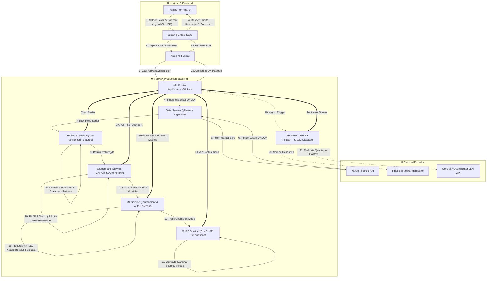

# 📈 AlphaVision AI — Institutional Quant & Equities Forecasting Platform

[](https://www.python.org/)
[](https://fastapi.tiangolo.com/)
[](https://nextjs.org/)
[](https://www.typescriptlang.org/)
[](https://tailwindcss.com/)
[](https://www.docker.com/)
[](https://opensource.org/licenses/MIT)

**AlphaVision AI** is an institutional-grade, full-stack quantitative equity analysis and multi-horizon price forecasting platform. It bridges classical econometric modeling (**GARCH**, **Auto-ARIMA**) with advanced machine learning ensembles (**XGBoost**, **LightGBM**, **CatBoost**, **Random Forest**, **LSTM/GRU**), Explainable AI (**TreeSHAP**), and real-time qualitative sentiment analysis via modern LLM cascades (**Conduit** / **OpenRouter**).

---

## 📑 Table of Contents

- [Architectural Overview](#-architectural-overview)
- [End-to-End Pipeline & Data Flow](#-end-to-end-pipeline--data-flow)
- [Core Engineering Highlights](#-core-engineering-highlights)
  - [Zero Data Leakage Time-Series Pipeline](#1-zero-data-leakage-time-series-pipeline)
  - [Automated Model Champion Tournament](#2-automated-model-champion-tournament)
  - [Econometric Volatility & Risk Corridors (GARCH)](#3-econometric-volatility--risk-corridors-garch)
  - [Explainable AI via TreeSHAP](#4-explainable-ai-via-treeshap)
  - [Qualitative Sentiment Overlay & RAG Analyst Chat](#5-qualitative-sentiment-overlay--rag-analyst-chat)
- [Technical Indicators & Feature Engineering](#-technical-indicators--feature-engineering)
- [Technology Stack](#-technology-stack)
- [Project Directory Structure](#-project-directory-structure)
- [API Reference](#-api-reference)
- [Getting Started & Local Setup](#-getting-started--local-setup)
- [Docker & Production Deployment](#-docker--production-deployment)
- [License](#-license)

---

## 🏛️ Architectural Overview

AlphaVision is designed with a high-performance decoupled architecture deployable as a high-density, single-container monolith:

1. **Client Tier (Next.js 15 App Router + Tailwind CSS + Lucide Icons):** Interactive financial terminal delivering real-time candlestick charts, multi-horizon forecast overlays with confidence corridors, model leaderboard comparison grids, SHAP feature importance charts, and an interactive conversational financial analyst.
2. **Server Tier (FastAPI + AsyncIO):** Asynchronous microservice engine orchestrating data ingestion, vectorized Pandas/NumPy feature generation, econometric modeling, ML training tournaments, and LLM completions.
3. **Quantitative & ML Engine (Scikit-Learn, XGBoost, LightGBM, CatBoost, Keras):** Strict chronological time-series cross-validation, hyperparameter-tuned tree ensembles, deep learning sequence models, and automated champion model selection.
4. **Econometrics Tier (arch, statsmodels):** GARCH(1,1) conditional heteroskedasticity estimation for dynamic risk envelopes, and Auto-ARIMA for classical statistical baselines.
5. **Explainability & NLP Tier (SHAP, FinBERT, Conduit/OpenRouter):** TreeSHAP feature attribution calculating marginal dollar impacts, accompanied by cascade LLM sentiment analysis (GPT-5.5, Claude 3.5 Sonnet, Llama 3.3 70B).

---

## 🔄 End-to-End Pipeline & Data Flow



---

## ⚡ Core Engineering Highlights

### 1. Zero Data Leakage Time-Series Pipeline
Financial time-series data is notoriously prone to lookahead bias and data leakage. AlphaVision enforces strict mathematical hygiene across every stage:
- **Chronological Splitting:** Never uses random train-test splits. Uses strict temporal order: **70% Training**, **15% Validation** (used exclusively for champion model selection), and **15% Out-of-Sample Test** (used strictly for unbiased performance evaluation).
- **Isolated Feature Scaling:** `RobustScaler` is fit **strictly on the Training partition** and only transforms the Validation and Test partitions, preventing future distributional shifts from leaking into the past.
- **Strict Backward-Looking Features:** All technical indicators are computed using vectorized `.shift()` and rolling backward-looking windows.
- **Target Isolation:** The target variable $Y_{t}$ is the Next-Day Close Price ($Close_{t+1}$). Full-timeline econometric and target-derived features (`arima_prediction`, `arima_residual`, `garch_volatility`) are explicitly stripped from the ML feature matrix prior to training.

### 2. Automated Model Champion Tournament
For every forecast request, AlphaVision dynamically trains and evaluates a portfolio of diverse models:
- **Tree Ensembles:** Random Forest, Gradient Boosting, XGBoost, LightGBM, CatBoost.
- **Deep Sequence Models:** Long Short-Term Memory (LSTM) and Gated Recurrent Unit (GRU).

Each model is evaluated on out-of-sample validation data across key quantitative metrics:
$$\text{RMSE} = \sqrt{\frac{1}{N}\sum_{i=1}^N (y_i - \hat{y}_i)^2} \qquad \text{MAE} = \frac{1}{N}\sum_{i=1}^N |y_i - \hat{y}_i| \qquad R^2 = 1 - \frac{\sum (y_i - \hat{y}_i)^2}{\sum (y_i - \bar{y})^2}$$

The system automatically crowns the **Champion Model** that maximizes $R^2$ while minimizing RMSE, and utilizes it to generate multi-horizon autoregressive forecasts (5, 10, 15, or 30 days).

### 3. Econometric Volatility & Risk Corridors (GARCH)
While machine learning estimates the expected price trajectory, risk management requires understanding the dispersion of potential outcomes.
- AlphaVision fits a **GARCH(1,1)** model on the stationary log returns:
  $$\sigma_t^2 = \omega + \alpha \epsilon_{t-1}^2 + \beta \sigma_{t-1}^2$$
- The estimated conditional volatility $\sigma_{t}$ dynamically scales with the forecast horizon $h$ ($\sigma_h = \sigma \sqrt{h}$) to construct **80% and 95% confidence corridors** around the ML prediction path.
- **Auto-ARIMA Baseline:** An independent ARIMA model runs concurrently to provide an authentic classical benchmark, demonstrating the exact alpha generated by the ML ensemble over traditional econometric methods.

### 4. Explainable AI via TreeSHAP
Financial institutions reject "black-box" models. AlphaVision implements **TreeSHAP** (Shapley Additive Explanations) grounded in cooperative game theory:
$$\phi_i = \sum_{S \subseteq F \setminus \{i\}} \frac{|S|!(|F| - |S| - 1)!}{|F|!} \left[ f(S \cup \{i\}) - f(S) \right]$$
- Traces exact tree pathways to evaluate the marginal contribution of each indicator to the final dollar forecast.
- Identifies whether factors like RSI oversold conditions, high VWAP volume, or Bollinger Band compression drove the bullish or bearish call.

### 5. Qualitative Sentiment Overlay & RAG Analyst Chat
- **Mathematical Isolation:** News sentiment does **not** bleed into the mathematical ML price features, preventing LLM hallucinations from corrupting quantitative forecasts.
- **Sentiment Scoring:** Scrapes real-time headlines and scores sentiment using FinBERT combined with an LLM fallback cascade via Conduit / OpenRouter (GPT-5.5, Claude 3.5 Sonnet, Llama 3.3 70B).
- **RAG Financial Analyst:** A built-in conversational analyst answers deep-dive equity questions with full live retrieval-augmented context (current quotes, technical indicators, ML forecast values, and recent news).

---

## 📊 Technical Indicators & Feature Engineering

AlphaVision transforms raw OHLCV market feeds into a rich multi-dimensional feature matrix:

| Category | Indicator | Period / Formula | Quantitative Purpose |
| :--- | :--- | :--- | :--- |
| **Returns & Stationarity** | Daily Returns & Log Returns | $\ln(Close_t / Close_{t-1})$ | Converts non-stationary prices into stationary distributions for stable model convergence. |
| **Trend & Momentum** | RSI (Relative Strength Index) | 14-day window | Measures velocity of price movements; detects overbought ($>70$) and oversold ($<30$) levels. |
| **Trend & Momentum** | MACD & Signal Line | EMA(12) - EMA(26), Signal EMA(9) | Identifies trend direction, momentum shifts, and bullish/bearish centerline crossovers. |
| **Trend & Momentum** | ADX (Avg Directional Index) | 14-day window | Quantifies trend strength independent of price direction. |
| **Trend & Momentum** | Normalized Trend Slope | 14-day linear regression slope | Measures the instantaneous trajectory angle of the price. |
| **Volatility** | Bollinger Bands (Upper/Lower) | 20-day SMA $\pm$ $2\sigma$ | Captures statistical dispersion and mean-reversion envelopes. |
| **Volatility** | ATR (Average True Range) | 14-day window | Quantifies absolute dollar volatility and market noise. |
| **Volatility** | Rolling Volatility | 20-day annualized std dev | Gauges medium-term turbulence in log returns. |
| **Volume & Flow** | VWAP (Volume-Weighted Avg Price) | $\sum(P \cdot V) / \sum V$ | Serves as institutional benchmark for true average execution price. |
| **Volume & Flow** | OBV (On-Balance Volume) | Cumulative signed volume | Detects institutional accumulation or distribution preceding price moves. |
| **Volume & Flow** | Chaikin Money Flow (CMF) | 20-day accumulation/distribution | Measures volume-weighted institutional buying and selling pressure. |
| **Oscillators** | Stochastic Oscillator (%K, %D) | 14-day high/low range, 3-day SMA | Pinpoints market turning points at momentum exhaustion. |
| **Oscillators** | Williams %R | 14-day range | Measures market extremes relative to the highest high. |
| **Oscillators** | CCI (Commodity Channel Index) | 20-day mean deviation | Identifies cyclical statistical extremes. |
| **Moving Averages** | EMA(20) & SMA(50) | Exponential & Simple | Standard trend alignment filters for golden/death cross detection. |

---

## 🛠️ Technology Stack

```
Frontend:
  ├── Next.js 15 (App Router, Static Export)
  ├── React 19 & TypeScript 5
  ├── Tailwind CSS 3.4
  ├── Zustand (Global Reactive State Management)
  ├── Lucide React (Financial & Dashboard Icons)
  └── Axios (API Client)

Backend:
  ├── FastAPI (High-performance Async ASGI Framework)
  ├── Python 3.10+
  ├── Uvicorn (ASGI Production Web Server)
  ├── Pydantic v2 (Strict Schema Validation & Settings)
  └── SQLite / aiosqlite (Local Metadata & Cache Storage)

Quantitative & Machine Learning:
  ├── Scikit-Learn (Pipelines, RobustScaler, Random Forest, GBDT)
  ├── XGBoost & LightGBM & CatBoost (Gradient Boosted Decision Trees)
  ├── TensorFlow / Keras (LSTM & GRU Sequence Models)
  ├── Statsmodels (Auto-ARIMA Statistical Baselines)
  ├── Arch (GARCH Conditional Volatility Modeling)
  └── SHAP (TreeSHAP Game-Theoretic Explainability)

Data & LLM Intelligence:
  ├── yFinance (Real-time and Historical Market Data Ingestion)
  ├── FinBERT / HuggingFace (Financial Sentiment NLP)
  └── Conduit API & OpenRouter (Multi-LLM Fallback: GPT-5.5, Claude 3.5 Sonnet, Llama 3.3 70B)

DevOps & Infrastructure:
  ├── Multi-stage Dockerfile (Frontend Static Export + FastAPI Monolith)
  └── Railway / Cloud Native Ready
```

---

## 📂 Project Directory Structure

```
stock_prediction_app/
├── Dockerfile                  # Multi-stage production container build
├── README.md                   # Project documentation
├── backend/
│   ├── main.py                 # FastAPI application entrypoint & static file server
│   ├── config.py               # Pydantic environment settings & LLM cascade router
│   ├── database.py             # Asynchronous database and in-memory caching engine
│   ├── requirements.txt        # Backend Python dependencies
│   ├── test_pipeline.py        # Comprehensive end-to-end integration test suite
│   ├── models/
│   │   └── schemas.py          # Pydantic data models and API response contracts
│   ├── routers/
│   │   ├── stocks.py           # Ticker search, metadata, and default symbols
│   │   ├── analysis.py         # Full quantitative pipeline orchestration
│   │   ├── news.py             # Financial news aggregation & sentiment
│   │   └── chat.py             # RAG conversational financial analyst
│   └── services/
│       ├── data_service.py     # Yahoo Finance historical OHLCV data ingestion
│       ├── technical_service.py# 15+ vectorized technical indicator calculations
│       ├── econometric_service.py # GARCH(1,1) volatility & Auto-ARIMA baseline
│       ├── ml_service.py       # ML tournament, anti-leakage splitting, autoregressive forecasting
│       ├── shap_service.py     # TreeSHAP feature importance & marginal attributions
│       ├── news_service.py     # Real-time news scraper & deduplication
│       ├── sentiment_service.py# FinBERT NLP & OpenRouter LLM sentiment analysis
│       ├── recommendation_service.py # Quantitative Buy/Hold/Sell decision matrix
│       └── rag_service.py      # Retrieval-augmented generation for financial chat
└── frontend/
    ├── package.json            # Node.js dependencies & scripts
    ├── next.config.ts          # Next.js configuration (configured for static export)
    ├── tailwind.config.ts      # Tailwind CSS styling and theme configuration
    └── src/
        ├── app/
        │   ├── layout.tsx      # Root application layout
        │   └── page.tsx        # Main trading terminal dashboard page
        ├── components/
        │   ├── header/         # Ticker search bar, quick stats, horizon selectors
        │   ├── charts/         # Candlestick, Forecast with GARCH Corridors, SHAP charts
        │   ├── dashboard/      # Model leaderboard grid, News feed, Recommendation card
        │   ├── chat/           # Interactive AI Financial Analyst drawer
        │   └── ui/             # Reusable UI primitives (Buttons, Cards, Badges)
        ├── store/
        │   └── useStockStore.ts# Centralized Zustand reactive application store
        └── types/
            └── stock.ts        # TypeScript interfaces matching backend schemas
```

---

## 🔌 API Reference

| Method | Endpoint | Description |
| :--- | :--- | :--- |
| `GET` | `/api/health` | Healthcheck and active LLM gateway status. |
| `GET` | `/api/stocks/search?q={query}` | Search equities across US and global exchanges (NYSE, NASDAQ, NSE). |
| `GET` | `/api/stocks/popular` | Retrieve curated list of benchmark stocks and indexes. |
| `GET` | `/api/analysis/{ticker}` | **Main Endpoint:** Executes full data, econometric, ML tournament, SHAP, and forecast pipeline. |
| `GET` | `/api/news/{ticker}` | Scrapes recent financial headlines and runs sentiment classification. |
| `POST` | `/api/chat` | Contextual RAG AI Analyst chat with real-time stock awareness. |

---

## 🚀 Getting Started & Local Setup

### Prerequisites
- **Python:** 3.10 or higher
- **Node.js:** 20.0 or higher
- **Git**

### 1. Clone the Repository
```bash
git clone https://github.com/Kishore-iitr/stock_prediction_app.git
cd stock_prediction_app
```

### 2. Configure Environment Variables
Copy the sample environment file in `backend/`:
```bash
cp backend/.env.example backend/.env
```
Open `backend/.env` and optionally configure your LLM gateway keys:
```env
# Optional: Conduit API key (https://conduit.ozdoev.net/v1)
CONDUIT_API_KEY=your_conduit_api_key_here

# Optional: OpenRouter API key (https://openrouter.ai/api/v1)
OPENROUTER_API_KEY=your_openrouter_api_key_here
```
*(Note: If no API keys are provided, the system gracefully falls back to local FinBERT and deterministic quantitative sentiment scoring).*

### 3. Backend Setup
```bash
cd backend
python -m venv venv

# On Windows:
venv\Scripts\activate
# On macOS/Linux:
source venv/bin/activate

pip install -r requirements.txt
python -m uvicorn main:app --reload --port 8000
```
Backend will be live at: `http://localhost:8000` (API Docs at `http://localhost:8000/docs`).

### 4. Frontend Setup
In a new terminal window:
```bash
cd frontend
npm install
npm run dev
```
Frontend will be live at: `http://localhost:3000`.

---

## 🐳 Docker & Production Deployment

AlphaVision is configured as a production-grade multi-stage Docker monolith where Next.js is statically exported and served directly through FastAPI:

### 1. Build and Run via Docker
```bash
# Build the unified container
docker build -t alphavision-ai .

# Run the container
docker run -p 8000:8000 -e PORT=8000 alphavision-ai
```
Access the complete application at `http://localhost:8000`.

### 2. Deploy to Railway
1. Fork or push this repository to GitHub.
2. Link your repository in [Railway.app](https://railway.app/).
3. Railway will automatically detect the root `Dockerfile`, build the Next.js assets, install Python dependencies, and bind the application to `$PORT`.

---

## 📄 License

This project is licensed under the **MIT License** — see the [LICENSE](LICENSE) file for details.
